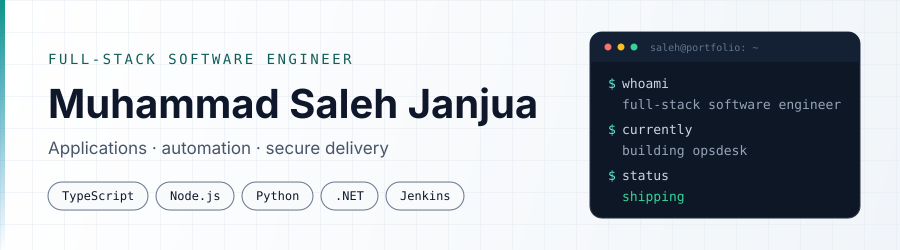

  <picture>
    <source media="(prefers-color-scheme: dark)" srcset="assets/hero-dark.svg">
    <source media="(prefers-color-scheme: light)" srcset="assets/hero-light.svg">
    
  </picture>

  I build full-stack applications and the delivery systems that ship them. 
  Computer Software Engineering · PAF-IAST · 2026

  <a href="https://portfolio-salesmayn.vercel.app/"><strong>Portfolio</strong></a>
  &nbsp;&nbsp;·&nbsp;&nbsp;
  <a href="https://www.linkedin.com/in/muhammadsalehjanjua"><strong>LinkedIn</strong></a>
  &nbsp;&nbsp;·&nbsp;&nbsp;
  <a href="mailto:MuhammadSalehJanjua@gmail.com"><strong>Email</strong></a>

## Selected work

<table>
  <tr>
    <td width="50%" valign="top">
      <strong><a href="https://github.com/salesmayn-code/OpsDesk">OpsDesk</a></strong> 
      <code>Next.js</code> <code>NestJS</code> <code>PostgreSQL</code> <code>Redis</code>  
      IT service management platform with ticket lifecycles, SLA automation, role-based access, asset management, incident workflows, and audit trails.
    </td>
    <td width="50%" valign="top">
      <strong><a href="https://github.com/salesmayn-code/MimaarAssociates">Mimaar Associates</a></strong> 
      <code>Next.js</code> <code>TypeScript</code> <code>Prisma</code> <code>Jenkins</code>  
      Company website and admin content platform delivered through a Jenkins pipeline to an Ubuntu VM.
    </td>
  </tr>
</table>

<table>
  <tr>
    <td width="50%" valign="top">
      <strong><a href="https://github.com/salesmayn-code/Cryptojacking_Detection_Tool">CryptoDetect</a></strong> 
      <code>Python</code> <code>FastAPI</code> <code>React</code> <code>XGBoost</code>  
      Cryptojacking detection with a Python monitoring agent, FastAPI backend, React dashboard, and Random Forest/XGBoost models.
    </td>
    <td width="50%" valign="top">
      <strong><a href="https://github.com/salesmayn-code/LinkPulse">LinkPulse</a></strong> 
      <code>.NET</code> <code>ASP.NET Core</code> <code>Blazor</code> <code>SQL Server</code>  
      Self-hostable URL shortener with click analytics, link expiration, and per-user ownership controls. In development.
    </td>
  </tr>
</table>

<table>
  <tr>
    <td width="50%" valign="top">
      <strong><a href="https://github.com/salesmayn-code/AgileCapacityTracker">Agile Capacity Tracker</a></strong> 
      <code>Java</code> <code>Spring Boot</code> <code>Next.js</code> <code>PostgreSQL</code>  
      Sprint and team-capacity dashboard with workload charts and GitHub issue synchronization.
    </td>
    <td width="50%" valign="top">
      <strong><a href="https://github.com/salesmayn-code/portfolio">Portfolio</a></strong> 
      <code>Next.js</code> <code>TypeScript</code> <code>Tailwind CSS</code> <code>Vercel</code>  
      The engineering portfolio behind this profile, presenting selected systems and the delivery work around them.
    </td>
  </tr>
</table>

  <a href="https://github.com/salesmayn-code?tab=repositories">All repositories</a>

## Stack

<table>
  <tr>
    <td width="50%" valign="top">
      <strong>Application</strong> 
      TypeScript · JavaScript · React · Next.js 
      Interfaces, state, and client data
    </td>
    <td width="50%" valign="top">
      <strong>Backend</strong> 
      Node.js · Express · NestJS · Python · FastAPI · .NET 
      APIs, background jobs, and domain workflows
    </td>
  </tr>
  <tr>
    <td width="50%" valign="top">
      <strong>Data</strong> 
      PostgreSQL · SQL Server · SQLite · Prisma · Redis 
      Schemas, migrations, queries, and caching
    </td>
    <td width="50%" valign="top">
      <strong>Delivery</strong> 
      Jenkins · GitHub Actions · Docker · PM2 · Nginx 
      Pipelines, containers, and production deployments
    </td>
  </tr>
  <tr>
    <td width="50%" valign="top">
      <strong>Quality</strong> 
      Jest · pytest · Playwright · API testing 
      Unit, integration, and end-to-end tests
    </td>
    <td width="50%" valign="top">
      <strong>Security</strong> 
      Authentication · RBAC · secrets management 
      Access control and audit trails
    </td>
  </tr>
</table>
## Delivery

I care about the path from commit to production, not just the application code.

  <code>checkout</code> → <code>install</code> → <code>lint</code> → <code>test</code> 
  <code>prisma migrate</code> → <code>build</code> → <code>rsync</code> → <code>pm2 restart</code>

The Mimaar Associates pipeline runs these stages in Jenkins, injects credentials from the Jenkins credential store, and deploys to an Ubuntu VM behind Nginx with PM2 supervising the process.

## Currently

Building **OpsDesk** — an IT service management platform with SLA automation, incident and change workflows, and a transactional outbox.
